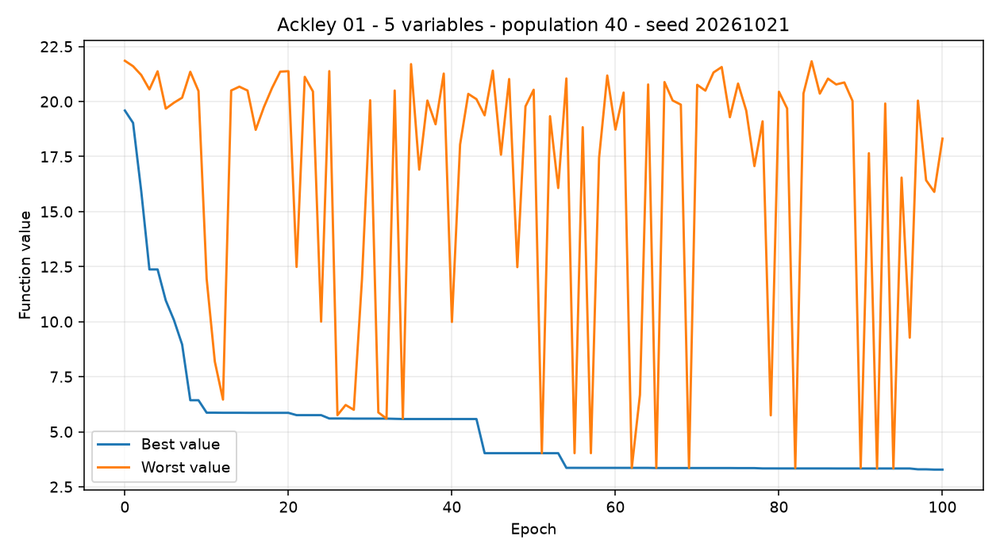
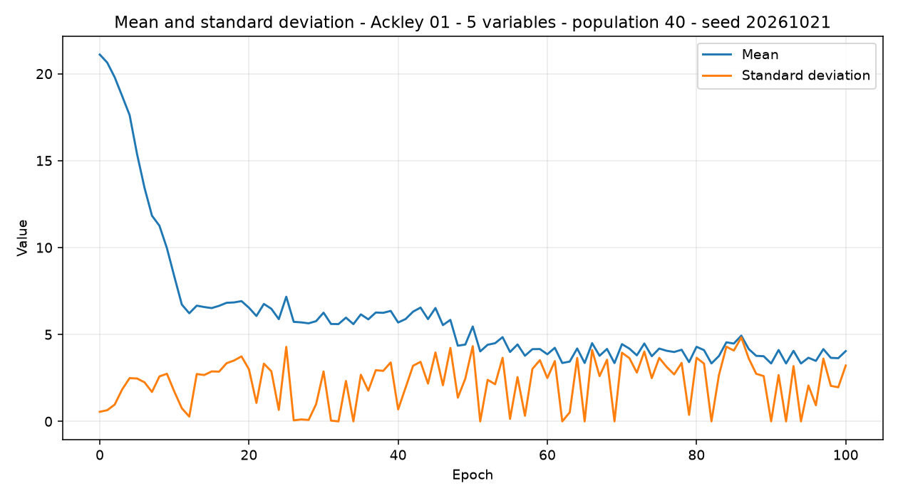
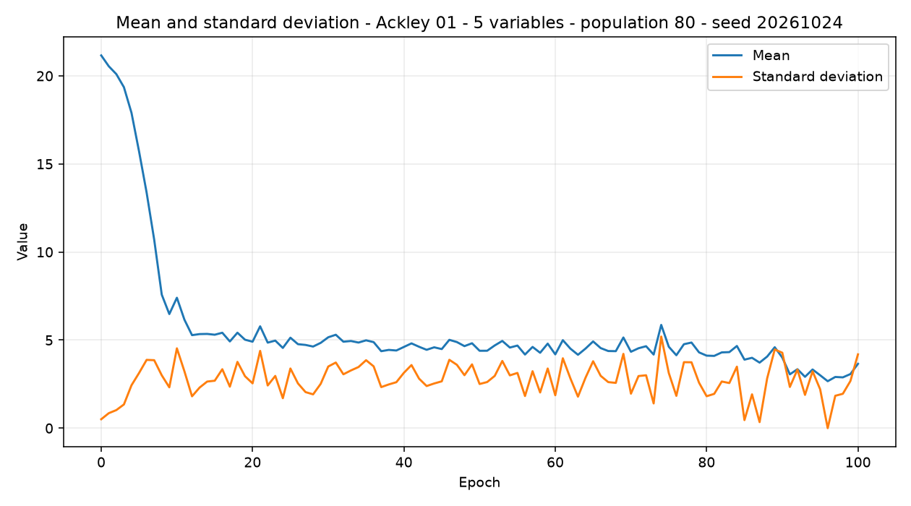
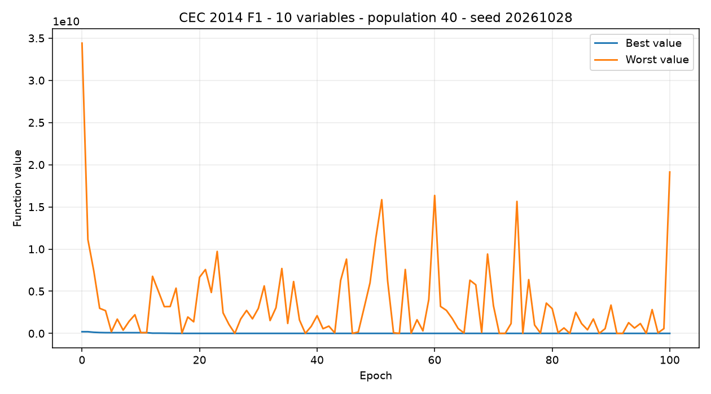
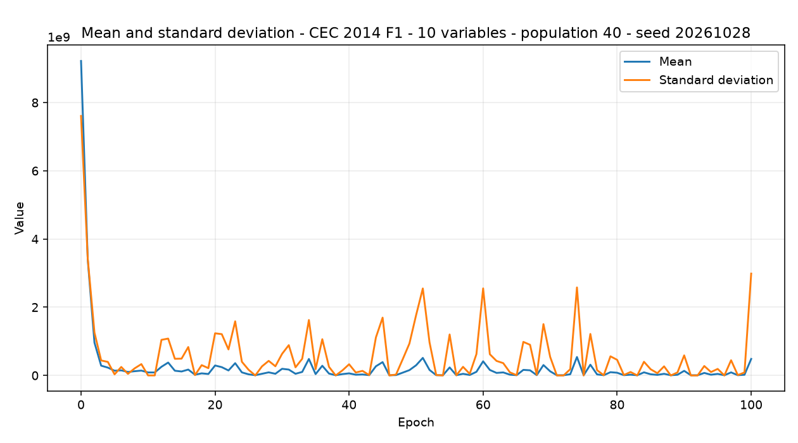
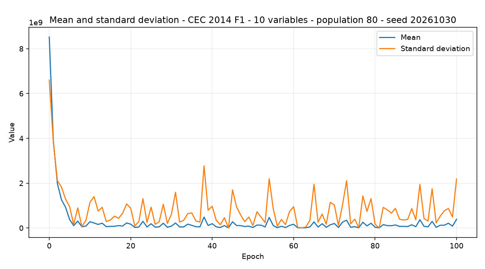

# Projekt 1
## Implementacja klasycznego algorytmu genetycznego

**Przedmiot:** Obliczenia ewolucyjne  
**Autorzy:** `[Imię i nazwisko 1]`, `[Imię i nazwisko 2]`  
**Data opracowania:** 21 października 2026 r.

> Przed wysłaniem pracy należy uzupełnić dane autorów, wstawić zrzut ekranu
> aplikacji i dołączyć nagranie demonstracyjne. Wartości w tabelach zostały
> obliczone na podstawie rzeczywistych uruchomień zapisanych w
> `sprawozdanie_p1/results.json`.

## Streszczenie

W ramach projektu opracowano graficzną aplikację służącą do uruchamiania
klasycznego algorytmu genetycznego z binarną reprezentacją chromosomu.
Aplikacja pozwala optymalizować funkcję celu w kierunku minimalizacji albo
maksymalizacji oraz konfigurować wszystkie podstawowe parametry algorytmu:
rozmiar populacji, liczbę epok, dokładność kodowania, selekcję, krzyżowanie,
mutację, inwersję i elityzm.

Do badań wybrano dwa benchmarki z biblioteki `opfunu`: Ackley 01 oraz
CEC 2014 F1. Wykonano cztery serie eksperymentalne, po 10 powtórzeń każdej
konfiguracji. Zbadano wpływ zwiększenia populacji z 40 do 80 osobników.
Większa populacja poprawiła średni wynik dla obu funkcji, ale zwiększyła
średni czas obliczeń. Dla funkcji Ackley najlepsza wartość wyniosła
`1,177541`, natomiast dla trudniejszej funkcji CEC 2014 F1 — `2511818,135797`.

## 1. Cel i zakres projektu

Celem projektu było:

1. zaimplementowanie klasycznego algorytmu genetycznego z binarnym
   chromosomem;
2. umożliwienie optymalizacji funkcji wielu zmiennych;
3. udostępnienie konfiguracji algorytmu z poziomu GUI;
4. zaimplementowanie wymaganych operatorów ewolucyjnych;
5. zapisywanie wyników kolejnych epok w bazie SQLite;
6. przedstawienie wyników za pomocą wykresów;
7. wykonanie powtarzalnych eksperymentów i porównanie konfiguracji.

Projekt nie implementuje funkcji benchmarkowych ręcznie. Funkcje są tworzone
przez bibliotekę `opfunu`, natomiast kod projektu odpowiada za reprezentację
chromosomu, operatory genetyczne, sterowanie przebiegiem algorytmu oraz
prezentację i zapis wyników.

## 2. Architektura aplikacji i przepływ danych

Aplikacja składa się z dwóch części:

- **frontend** — formularz konfiguracji, przyciski uruchamiania, historia,
  tabele i wykresy;
- **backend** — walidacja konfiguracji, uruchomienie algorytmu, wywołanie
  funkcji benchmarkowej, zapis wyników i udostępnienie API.

Przepływ danych:

```text
formularz GUI
    -> żądanie JSON
    -> FastAPI
    -> walidacja parametrów
    -> GeneticAlgorithm
    -> opfunu / ocena funkcji
    -> wynik i historia epok
    -> SQLite
    -> odpowiedź JSON
    -> tabela, wykresy i historia uruchomień
```

Pojedyncze uruchomienie zapisuje seed, parametry konfiguracji, najlepszy
wektor, wartość funkcji, czas obliczeń oraz statystyki wszystkich epok.
Eksperyment jest serią niezależnych uruchomień. Każde powtórzenie otrzymuje
osobny seed, ale wszystkie rekordy mają wspólny identyfikator eksperymentu.
Dzięki temu można odtworzyć przebieg albo wyeksportować wynik do CSV.

**Rysunek 1.** Formularz konfiguracji Projektu 1 w działającej aplikacji.  


Zrzut przedstawia widok Projektu 1 z formularzem konfiguracji funkcji,
liczby zmiennych, kierunku optymalizacji oraz parametrów przebiegu. Tabela
wyników i wykresy są dostępne niżej na tej samej stronie po uruchomieniu
algorytmu.

## 3. Technologie i organizacja kodu

| Obszar | Technologia |
|---|---|
| Język backendu | Python |
| API | FastAPI, Uvicorn |
| Obliczenia numeryczne | NumPy |
| Funkcje testowe | opfunu |
| Baza danych | SQLite, SQLAlchemy |
| Interfejs | JavaScript, HTML, SCSS |
| Budowanie frontendu | Vite, npm |
| Komponenty UI | Bootstrap |
| Wykresy | Chart.js |
| Testy | unittest |

Najważniejsze klasy i struktury:

- `GAConfig` — przechowuje i waliduje konfigurację;
- `BinaryChromosome` — koduje i dekoduje wartości rzeczywiste;
- `Individual` — reprezentuje osobnika wraz z genami, wartościami i oceną;
- `GenerationStats` — przechowuje statystyki jednej epoki;
- `GARunResult` — przechowuje wynik całego przebiegu;
- `GeneticAlgorithm` — wykonuje kolejne etapy algorytmu.

## 4. Wymagania i uruchomienie

Wymagane środowisko:

- Windows 10 lub Windows 11,
- Python 3.10 lub nowszy,
- Node.js 18 lub nowszy,
- npm.

Uruchomienie backendu:

```powershell
py -m venv .venv
.\.venv\Scripts\Activate.ps1
python -m pip install -r requirements.txt
python -m uvicorn backend.main:app --reload
```

Uruchomienie frontendu:

```powershell
cd frontend
npm install
npm run dev
```

W trybie developerskim interfejs jest dostępny pod adresem
`http://localhost:5173`. Po zbudowaniu frontendu można uruchomić sam backend
i korzystać z aplikacji pod adresem `http://localhost:8000`.

## 5. Implementacja algorytmu

### 5.1. Kodowanie binarne

Każdy chromosom składa się z fragmentów bitów odpowiadających kolejnym
zmiennym. Dla zmiennej z przedziału `[a,b]` wartość całkowita zakodowana
w `l` bitach jest mapowana na przedział funkcji według zależności:

```text
x = a + (b - a) * q / (2^l - 1)
```

gdzie `q` jest liczbą całkowitą reprezentowaną przez dany fragment bitów.
Liczba bitów jest wyznaczana automatycznie z zakresu funkcji i ustawionej
liczby cyfr dokładności. W badaniu użyto dokładności 8 cyfr dziesiętnych.

### 5.2. Schemat pojedynczej epoki

W każdej epoce wykonywane są następujące kroki:

1. ocena wszystkich osobników;
2. zapis statystyk populacji;
3. skopiowanie osobników elitarnych;
4. wybór rodziców;
5. krzyżowanie z ustalonym prawdopodobieństwem;
6. mutacja potomków;
7. opcjonalna inwersja chromosomu;
8. uzupełnienie populacji do wymaganego rozmiaru;
9. ocena nowej populacji.

Po ostatniej epoce wybierany jest osobnik o najlepszej wartości funkcji.
W przypadku minimalizacji najlepsza jest wartość najmniejsza, a w przypadku
maksymalizacji — największa.

### 5.3. Zaimplementowane operatory

**Selekcja**

- najlepszych osobników,
- najgorszych osobników,
- ruletkowa,
- turniejowa z konfigurowanym rozmiarem turnieju.

**Krzyżowanie**

- jednopunktowe,
- dwupunktowe,
- jednorodne,
- ziarniste.

**Mutacja**

- brzegowa,
- jednopunktowa,
- dwupunktowa.

Ponadto dostępna jest inwersja losowego fragmentu chromosomu oraz elityzm
wyrażony liczbą osobników albo procentem populacji. Wszystkie operatory mają
konfigurowane prawdopodobieństwa tam, gdzie jest to wymagane.

### 5.4. Ocena osobników i statystyki

Wartość funkcji benchmarkowej jest jednocześnie wartością ocenianą przez
algorytm. Dla minimalizacji osobniki są porządkowane rosnąco według:

```text
cel(x) = f(x) -> min
```

Dla maksymalizacji porządek jest odwrócony:

```text
cel(x) = f(x) -> max
```

W każdej epoce zapisywane są: najlepsza wartość, najgorsza wartość, średnia
arytmetyczna oraz odchylenie standardowe populacji. Dla populacji
`v1, v2, ..., vn` średnia jest obliczana jako:

```text
mean = (v1 + v2 + ... + vn) / n
```

Odchylenie standardowe jest liczone z użyciem `numpy.std` dla całej
aktualnej populacji. W tabelach wyników odchylenie oznacza natomiast
odchylenie standardowe **10 końcowych wyników niezależnych powtórzeń**;
obie wartości są rozróżnione w opisie tabel.

## 6. Funkcje benchmarkowe

### 6.1. Ackley 01

Funkcja jest tworzona przez klasę
`opfunu.name_based.a_func.Ackley01`. W aplikacji obsługiwane są wymiary
od 2 do 30, a zakres każdej zmiennej to `[-35, 35]`.

| Właściwość | Wartość |
|---|---|
| Kierunek badania | minimalizacja |
| Wartość optimum | `0` |
| Argument optimum dla 5 zmiennych | `(0, 0, 0, 0, 0)` |
| Wymiar wykorzystany w eksperymencie | 5 |

Wykorzystana postać funkcji Ackley 01 jest następująca:

```text
f(x) = -20 exp(-0,2 sqrt((1/n) sum(x_i^2)))
       - exp((1/n) sum(cos(2 pi x_i))) + 20 + exp(1)
```

Funkcja jest ciągła, skalowalna i wielomodalna. Jej globalne minimum
znajduje się w punkcie zerowym.

### 6.2. CEC 2014 F1

Funkcja jest tworzona przez klasę
`opfunu.cec_based.cec2014.F12014`. Jest to funkcja Rotated High Conditioned
Elliptic z zestawu CEC 2014. Aplikacja obsługuje wymiary 10, 20, 30, 50 i 100,
a zakres każdej zmiennej to `[-100, 100]`.

| Właściwość | Wartość |
|---|---|
| Kierunek badania | minimalizacja |
| Wartość optimum | `100` |
| Wymiar wykorzystany w eksperymencie | 10 |
| Źródło argumentu optimum | `x_global` z biblioteki `opfunu` |

Argument optimum dla 10 zmiennych:

```text
(50.3557898229, 64.9267099321, -59.6821093930, 66.1401369822,
 21.1774793961, -64.3935352001, -35.4402849813, 7.5010430728,
 73.2010936695, 74.3821656319)
```

CEC 2014 F1 jest obróconą funkcją eliptyczną o złym uwarunkowaniu. Jej
wartość jest obliczana przez implementację `F12014`, która korzysta
z parametrów benchmarku CEC, w tym wektora przesunięcia i macierzy obrotu.
Z tego powodu nie zastępowano jej uproszczonym wzorem w kodzie projektu:
wywoływana jest referencyjna implementacja biblioteki `opfunu`.

### 6.3. Porównanie optimum z najlepszymi rozwiązaniami

| Funkcja | Wymiar | Optimum | Najlepszy wynik | Błąd bezwzględny |
|---|---:|---:|---:|---:|
| Ackley 01 | 5 | 0 | 1,177541 | 1,177541 |
| CEC 2014 F1 | 10 | 100 | 2511818,135797 | 2511718,135797 |

Powyższa tabela dotyczy najlepszego wyniku uzyskanego spośród wszystkich
10 powtórzeń konfiguracji z większą populacją.

### 6.4. Wizualizacja funkcji testowych

Funkcje mają odpowiednio 5 i 10 zmiennych, dlatego nie można przedstawić ich
bezpośrednio na jednym wykresie przestrzennym. Na poniższych rysunkach
pokazano dwuwymiarowe przekroje funkcji. Na wykresie Ackley zmienne `x3`, `x4`
i `x5` są ustalone na wartości 0, czyli na wartościach optimum. Na wykresie
CEC 2014 F1 zmienne `x3`-`x10` są ustalone na wartościach wektora `x_global`
z biblioteki `opfunu`. Osie `x1` i `x2` pozostają zmienne.

Takie przekroje nie zastępują pełnej wizualizacji przestrzeni
5- lub 10-wymiarowej, ale pozwalają pokazać kształt badanej funkcji
w dwóch wybranych kierunkach oraz położenie obszaru minimum.

**Rysunek 2.** Dwuwymiarowy przekrój funkcji Ackley 01 dla `x3=x4=x5=0`.


**Rysunek 3.** Dwuwymiarowy przekrój funkcji CEC 2014 F1 dla
`x3...x10=x_global`.


## 7. Metodyka eksperymentu

Badanie miało odpowiedzieć na pytanie, czy zwiększenie populacji z 40 do 80
osobników poprawi jakość rozwiązania oraz jak wpłynie na czas obliczeń.
Zmieniano tylko rozmiar populacji. Dla każdej funkcji i każdego rozmiaru
populacji wykonano 10 niezależnych uruchomień.

Wspólne parametry:

| Parametr | Wartość |
|---|---|
| Liczba epok | 100 |
| Dokładność | 8 cyfr dziesiętnych |
| Selekcja | turniejowa |
| Rozmiar turnieju | 3 |
| Krzyżowanie | dwupunktowe |
| Prawdopodobieństwo krzyżowania | 0,80 |
| Mutacja | jednopunktowa |
| Prawdopodobieństwo mutacji | 0,02 |
| Prawdopodobieństwo inwersji | 0,05 |
| Elityzm | 2 osobniki |
| Seed bazowy | 20261021 |
| Seedy powtórzeń | 20261021-20261030 |

Badano następujące konfiguracje:

| Oznaczenie | Funkcja | Wymiar | Populacja |
|---|---|---:|---:|
| A40 | Ackley 01 | 5 | 40 |
| A80 | Ackley 01 | 5 | 80 |
| C40 | CEC 2014 F1 | 10 | 40 |
| C80 | CEC 2014 F1 | 10 | 80 |

## 8. Wyniki eksperymentu

Wartość średnia jest średnią z 10 końcowych wartości funkcji. Odchylenie
standardowe pokazuje zmienność wyników pomiędzy powtórzeniami. Czas jest
średnim czasem jednego uruchomienia mierzonym przez aplikację.

| Konfiguracja | Średnia | Odchylenie wyników | Najlepszy | Najgorszy | Średni czas | Średni błąd |
|---|---:|---:|---:|---:|---:|---:|
| A40 | 7,781117 | 3,959438 | 3,279268 | 15,241120 | 0,142793 s | 7,781117 |
| A80 | 2,808891 | 1,249687 | 1,177541 | 5,784062 | 0,333568 s | 2,808891 |
| C40 | 35175982,695209 | 30065618,856460 | 5522096,560916 | 88354341,571106 | 0,278766 s | 35175882,695209 |
| C80 | 14986860,309951 | 11056324,600942 | 2511818,135797 | 38758508,484090 | 0,558057 s | 14986760,309951 |

### 8.1. Wyniki wszystkich powtórzeń — Ackley 01

Poniższe tabele pokazują wynik końcowy i czas **każdego** z 10 uruchomień.
Nie są to dane przykładowe — wartości zostały odczytane z pliku
`results.json`, wygenerowanego po wykonaniu eksperymentu.

#### Konfiguracja A40 — populacja 40

| Nr | Seed | Wynik końcowy | Czas [s] |
|---:|---:|---:|---:|
| 1 | 20261021 | 3,279268 | 0,146574 |
| 2 | 20261022 | 5,531326 | 0,179524 |
| 3 | 20261023 | 15,241120 | 0,154701 |
| 4 | 20261024 | 13,594353 | 0,152918 |
| 5 | 20261025 | 4,894218 | 0,149395 |
| 6 | 20261026 | 5,143547 | 0,131595 |
| 7 | 20261027 | 7,746566 | 0,127793 |
| 8 | 20261028 | 10,068359 | 0,131510 |
| 9 | 20261029 | 6,664390 | 0,128259 |
| 10 | 20261030 | 5,648023 | 0,125664 |

#### Konfiguracja A80 — populacja 80

| Nr | Seed | Wynik końcowy | Czas [s] |
|---:|---:|---:|---:|
| 1 | 20261021 | 1,960163 | 0,344011 |
| 2 | 20261022 | 2,555958 | 0,367348 |
| 3 | 20261023 | 2,435915 | 0,348461 |
| 4 | 20261024 | 1,177541 | 0,327206 |
| 5 | 20261025 | 5,784062 | 0,332096 |
| 6 | 20261026 | 3,241538 | 0,321047 |
| 7 | 20261027 | 1,991259 | 0,317198 |
| 8 | 20261028 | 3,544512 | 0,333037 |
| 9 | 20261029 | 3,013694 | 0,326152 |
| 10 | 20261030 | 2,384269 | 0,319129 |

### 8.2. Wyniki wszystkich powtórzeń — CEC 2014 F1

#### Konfiguracja C40 — populacja 40

| Nr | Seed | Wynik końcowy | Czas [s] |
|---:|---:|---:|---:|
| 1 | 20261021 | 6004328,804217 | 0,260524 |
| 2 | 20261022 | 59075114,974811 | 0,266304 |
| 3 | 20261023 | 7004925,023579 | 0,257050 |
| 4 | 20261024 | 20384531,639138 | 0,262353 |
| 5 | 20261025 | 39616877,185804 | 0,249580 |
| 6 | 20261026 | 69537819,646911 | 0,260266 |
| 7 | 20261027 | 88354341,571106 | 0,343330 |
| 8 | 20261028 | 5522096,560916 | 0,295840 |
| 9 | 20261029 | 9503561,916493 | 0,287199 |
| 10 | 20261030 | 46756229,629115 | 0,305212 |

#### Konfiguracja C80 — populacja 80

| Nr | Seed | Wynik końcowy | Czas [s] |
|---:|---:|---:|---:|
| 1 | 20261021 | 10903148,225965 | 0,556259 |
| 2 | 20261022 | 2699144,353016 | 0,535898 |
| 3 | 20261023 | 38758508,484090 | 0,537838 |
| 4 | 20261024 | 16661382,949573 | 0,573604 |
| 5 | 20261025 | 15816731,289591 | 0,566323 |
| 6 | 20261026 | 11949195,013736 | 0,539453 |
| 7 | 20261027 | 27660308,709952 | 0,606805 |
| 8 | 20261028 | 8855896,414014 | 0,556920 |
| 9 | 20261029 | 14052469,523777 | 0,564159 |
| 10 | 20261030 | 2511818,135797 | 0,543314 |

### 8.3. Punkty kontrolne zbieżności najlepszego uruchomienia

W tabelach podano wartości z epok 0, 10, 20, 40, 60, 80 i 100. Kolumna
„najlepszy osobnik” jest zgodna z kierunkiem minimalizacji. Kolumny „średnia”
i „odchylenie” dotyczą całej populacji w danej epoce.

#### Ackley 01 — najlepszy przebieg A40, seed 20261021

| Epoka | Najlepszy osobnik | Średnia populacji | Odchylenie |
|---:|---:|---:|---:|
| 0 | 19,590866 | 21,103543 | 0,552690 |
| 10 | 5,865654 | 8,324136 | 1,707089 |
| 20 | 5,858127 | 6,538084 | 2,994771 |
| 40 | 5,577488 | 5,687769 | 0,688381 |
| 60 | 3,358737 | 3,861016 | 2,491752 |
| 80 | 3,333018 | 4,291782 | 3,660413 |
| 100 | 3,279268 | 4,045377 | 3,213674 |

#### Ackley 01 — najlepszy przebieg A80, seed 20261024

| Epoka | Najlepszy osobnik | Średnia populacji | Odchylenie |
|---:|---:|---:|---:|
| 0 | 19,714197 | 21,161243 | 0,505852 |
| 10 | 5,011404 | 7,404140 | 4,531349 |
| 20 | 4,362752 | 4,908018 | 2,543881 |
| 40 | 3,989812 | 4,611282 | 3,144755 |
| 60 | 3,964301 | 4,189414 | 1,868240 |
| 80 | 3,878623 | 4,116812 | 1,813209 |
| 100 | 1,177541 | 3,653825 | 4,190448 |

#### CEC 2014 F1 — najlepszy przebieg C40, seed 20261028

| Epoka | Najlepszy osobnik | Średnia populacji | Odchylenie |
|---:|---:|---:|---:|
| 0 | 202676462,233383 | 9220260434,114967 | 7607829862,875679 |
| 10 | 86992253,223171 | 88213379,410117 | 1148642,493330 |
| 20 | 6350092,428947 | 291834191,261080 | 1235740232,663043 |
| 40 | 6269049,359503 | 61301520,904246 | 327321464,116031 |
| 60 | 5802840,657077 | 414972549,607007 | 2552046051,971758 |
| 80 | 5790042,025183 | 79001858,896763 | 457207649,822128 |
| 100 | 5522096,560916 | 483985934,862858 | 2986266738,022678 |

#### CEC 2014 F1 — najlepszy przebieg C80, seed 20261030

| Epoka | Najlepszy osobnik | Średnia populacji | Odchylenie |
|---:|---:|---:|---:|
| 0 | 121928347,578529 | 8521562649,326147 | 6598203437,094655 |
| 10 | 10190932,788254 | 279541909,453413 | 1146397960,002944 |
| 20 | 8334137,793162 | 169272592,376741 | 883734219,715303 |
| 40 | 4257218,767619 | 191071715,496914 | 969462268,455476 |
| 60 | 4180672,219989 | 165296826,179430 | 946219310,488505 |
| 80 | 4059047,612438 | 34416084,524948 | 169402043,769073 |
| 100 | 2511818,135797 | 389370245,810266 | 2189121465,690152 |

### 8.4. Najlepsze rozwiązania w poszczególnych konfiguracjach

Poniższa tabela zawiera wektor znaleziony w najlepszym powtórzeniu każdej
konfiguracji. Wektor jest zapisany w kolejności `x1, x2, ...`.

| Konfiguracja | Seed najlepszego przebiegu | Wartość funkcji | Najlepszy wektor |
|---|---:|---:|---|
| A40 | 20261021 | 3,279268 | `(-1,110861; -0,947086; 0,039387; -1,055346; 0,103099)` |
| A80 | 20261024 | 1,177541 | `(-0,004680; 0,275717; 0,106853; -0,006809; -0,000536)` |
| C40 | 20261028 | 5522096,560916 | `(16,307372; 83,005009; -78,578993; 65,377297; 67,972659; -58,863022; 11,083457; -9,569003; 60,349688; 31,300546)` |
| C80 | 20261030 | 2511818,135797 | `(32,565691; 91,803093; -71,769469; 48,393731; 87,284685; -62,676869; 18,618175; -1,958085; 66,079735; 50,926161)` |

### 8.5. Wpływ rozmiaru populacji

W przypadku Ackley zwiększenie populacji poprawiło średni wynik z `7,781117`
do `2,808891`, czyli o około 63,9%. Najlepszy pojedynczy wynik poprawił się
z `3,279268` do `1,177541`. Odchylenie standardowe zmniejszyło się z
`3,959438` do `1,249687`, co wskazuje na większą stabilność większej
populacji. Średni czas wzrósł z `0,142793 s` do `0,333568 s`.

Dla CEC 2014 F1 średnia wartość zmniejszyła się z `35175982,695209` do
`14986860,309951`, czyli o około 57,4%. Najlepszy wynik poprawił się z
`5522096,560916` do `2511818,135797`, a odchylenie standardowe zmalało z
`30065618,856460` do `11056324,600942`. Czas wzrósł z `0,278766 s` do
`0,558057 s`.

W obu przypadkach większa populacja dała lepsze wyniki, ale wymagała około
2,34 raza dłuższego obliczenia dla Ackley i około 2,00 raza dłuższego dla
CEC 2014 F1.

### 8.6. Ocena trudniejszej funkcji

Dla CEC 2014 F1 nie osiągnięto optimum `100`. Najlepszy wynik `2511818,135797`
jest od niego znacznie oddalony. W badanym ustawieniu 100 epok i binarna
reprezentacja nie wystarczyły do dokładnego znalezienia minimum. Wynik
pokazuje jednak poprawny kierunek zmian: zwiększenie populacji obniżyło
zarówno średnią, jak i najlepszą uzyskaną wartość.

Nie należy porównywać bezpośrednio wartości liczbowych Ackley i CEC 2014 F1,
ponieważ są to różne funkcje o różnych skalach. Porównanie powinno odbywać
się wewnątrz tego samego benchmarku.

### 8.7. Kontrola trybu maksymalizacji

Główne badanie wykonano dla minimalizacji, ponieważ pozwalało porównać
wyniki z minimami benchmarków. Niezależnie sprawdzono również drugi tryb
wymagany przez projekt. Dla funkcji Ackley 01 uruchomiono tę samą klasę
algorytmu z celem `maximize`, populacją 10 osobników, 10 epokami,
dokładnością 4 cyfr i seedem `20261021`.

| Cel | Funkcja | Wymiar | Populacja | Epoki | Seed | Wynik |
|---|---|---:|---:|---:|---:|---:|
| minimalizacja | Ackley 01 | 2 | 10 | 10 | 20261021 | 11,640998 |
| maksymalizacja | Ackley 01 | 2 | 10 | 10 | 20261021 | 22,279438 |

Wynik maksymalizacji jest większy od wyniku minimalizacji, co potwierdza,
że parametr celu wpływa na porządkowanie osobników, selekcję, elityzm
i wybór końcowego rozwiązania. To uruchomienie jest testem funkcjonalnym
trybu maksymalizacji, a nie częścią głównego porównania statystycznego.

## 9. Najlepsze przebiegi i wykresy

Wykresy przedstawiają najlepsze pojedyncze uruchomienie spośród 10 powtórzeń
danej konfiguracji. Pierwszy wykres dla konfiguracji pokazuje najlepszą
i najgorszą wartość populacji w kolejnych epokach. Drugi przedstawia średnią
i odchylenie standardowe populacji.

**Rysunek 4.** Ackley 01, 5 zmiennych, populacja 40, seed `20261021` —
najlepsza i najgorsza wartość.



**Rysunek 5.** Ackley 01, 5 zmiennych, populacja 40, seed `20261021` —
średnia i odchylenie standardowe.



**Rysunek 6.** Ackley 01, 5 zmiennych, populacja 80, seed `20261024` —
najlepsza i najgorsza wartość.


**Rysunek 7.** Ackley 01, 5 zmiennych, populacja 80, seed `20261024` —
średnia i odchylenie standardowe.



**Rysunek 8.** CEC 2014 F1, 10 zmiennych, populacja 40, seed `20261028` —
najlepsza i najgorsza wartość.



**Rysunek 9.** CEC 2014 F1, 10 zmiennych, populacja 40, seed `20261028` —
średnia i odchylenie standardowe.



**Rysunek 10.** CEC 2014 F1, 10 zmiennych, populacja 80, seed `20261030` —
najlepsza i najgorsza wartość.


**Rysunek 11.** CEC 2014 F1, 10 zmiennych, populacja 80, seed `20261030` —
średnia i odchylenie standardowe.



Najlepszy przebieg Ackley A80 zakończył się wynikiem `1,177541` dla wektora:

```text
(-0,004680; 0,275717; 0,106853; -0,006809; -0,000536)
```

Najlepszy przebieg CEC 2014 F1 C80 zakończył się wynikiem `2511818,135797`
dla wektora:

```text
(32,565691; 91,803093; -71,769469; 48,393731; 87,284685;
 -62,676869; 18,618175; -1,958085; 66,079735; 50,926161)
```

## 10. Zapis wyników i odtwarzalność

Po każdym uruchomieniu w bazie zapisuje się:

- identyfikator uruchomienia,
- seed,
- wersja algorytmu,
- pełna konfiguracja,
- najlepszy wektor,
- końcowa wartość funkcji,
- czas obliczeń,
- historia statystyk epok.

Zapis seedów umożliwia powtórzenie eksperymentu. Dla każdej konfiguracji
wyniki surowe zostały zachowane w pliku `sprawozdanie_p1/results.json`.
Pojedyncze uruchomienia mogą być także eksportowane do CSV z poziomu
interfejsu historii.

## 11. Weryfikacja implementacji

Wykonano testy:

- kodowania i dekodowania chromosomu,
- walidacji zakresów i parametrów,
- czterech metod selekcji,
- czterech metod krzyżowania,
- trzech metod mutacji,
- inwersji,
- elityzmu,
- powtarzalności dla tego samego seeda,
- endpointów API,
- zapisu do SQLite,
- eksportu CSV.

Pełny zestaw obejmował 49 testów i zakończył się wynikiem `OK`. Dodatkowo
test składni JavaScript oraz produkcyjny build frontendu zakończyły się
pomyślnie.

## 12. Wnioski

1. Zaimplementowany algorytm spełnia wymagania dotyczące binarnej
   reprezentacji, konfiguracji populacji i epok oraz operatorów genetycznych.
2. Interfejs graficzny pozwala zmienić parametry bez modyfikowania kodu.
3. Zwiększenie populacji z 40 do 80 osobników poprawiło wynik dla obu
   testowanych funkcji i jednocześnie zwiększyło czas obliczeń.
4. Ackley 01 była wyraźnie łatwiejsza do optymalizacji niż CEC 2014 F1.
5. Powtarzanie uruchomień jest konieczne: losowość wpływa na wynik, a większa
   populacja zmniejszyła rozrzut wyników w przeprowadzonym badaniu.
6. W badanym ustawieniu nie można stwierdzić, że algorytm znajduje optimum
   CEC 2014 F1. Można jedynie stwierdzić, że większa populacja poprawiła
   uzyskane przybliżenie.

Ograniczeniem eksperymentu było użycie jednego wymiaru dla każdej funkcji,
dwóch rozmiarów populacji i 100 epok. W dalszych badaniach warto porównać
również inne selekcje, krzyżowania i mutacje, zwiększyć liczbę epok oraz
sprawdzić wymiary 20 i 30.

## 13. Załączniki do wersji końcowej

- [ ] Uzupełnione imiona i nazwiska autorów.
- [x] Rysunek 1 — zrzut ekranu aplikacji.
- [x] Pliki PNG z katalogu `sprawozdanie_p1`.
- [x] Plik `results.json` z surowymi wynikami.
- [ ] Nagranie demonstracyjne trwające około 1–2 minut.
- [ ] Archiwum o nazwie `P1_Nazwisko1Imie1_Nazwisko2Imie2.zip`.

## 14. Źródła

1. `opfunu` — implementacje `Ackley01` oraz `F12014`.
2. CEC 2014 — zestaw funkcji testowych, funkcja F1.
3. FastAPI, <https://fastapi.tiangolo.com/>.
4. NumPy, <https://numpy.org/doc/>.
5. SQLAlchemy, <https://docs.sqlalchemy.org/>.
6. Chart.js, <https://www.chartjs.org/docs/latest/>.
