# Projekt 1 - klasyczny algorytm genetyczny

**Przedmiot:** Obliczenia ewolucyjne  
**Autorzy:** .................................................................  
**Data:** 21 października 2026 r.

## Streszczenie

W projekcie wykonano graficzną aplikację do optymalizacji funkcji
wielowymiarowych za pomocą klasycznego algorytmu genetycznego. Chromosom ma
reprezentację binarną, a użytkownik może zmieniać dokładność, rozmiar
populacji, liczbę epok, metodę selekcji, krzyżowanie, mutację, inwersję
i elityzm. Aplikacja obsługuje minimalizację i maksymalizację, pokazuje czas
obliczeń, rysuje wykresy i zapisuje historię wyników w SQLite.

Do testów użyto dwóch funkcji z biblioteki `opfunu`: Ackley 01 oraz CEC 2014
F1. Najpierw porównano populacje 40 i 80 osobników przy 100 epokach.
Następnie wykonano dodatkowe eksperymenty dla 1000 epok i populacji 200 oraz
dla 5000 epok i populacji 10. Każda konfiguracja została powtórzona 10 razy.
Wyniki pokazują, że dla Ackley większa populacja i większa liczba epok
pozwalają praktycznie osiągnąć minimum 0. Dla CEC 2014 F1 lepsza okazała się
populacja 200 i 1000 epok, ale optimum nie zostało znalezione.

## 1. Cel projektu

Celem projektu było:

- zaimplementowanie binarnego algorytmu genetycznego;
- umożliwienie optymalizacji funkcji o dowolnej obsługiwanej liczbie zmiennych;
- dodanie konfiguracji algorytmu w interfejsie graficznym;
- implementacja wymaganych operatorów genetycznych;
- pomiar czasu obliczeń;
- prezentacja przebiegu optymalizacji na wykresach;
- zapis wyników kolejnych epok;
- wykonanie powtarzalnych eksperymentów i porównanie konfiguracji.

## 2. Technologie i uruchomienie

| Element | Wykorzystana technologia |
|---|---|
| Backend | Python, FastAPI, Uvicorn |
| Obliczenia | NumPy |
| Funkcje testowe | opfunu |
| Baza danych | SQLite, SQLAlchemy |
| Frontend | JavaScript, HTML, SCSS |
| Budowanie | Vite, npm |
| Interfejs | Bootstrap |
| Wykresy | Chart.js |
| Testy | unittest |

Wymagane środowisko to Windows 10/11, Python 3.10 lub nowszy oraz Node.js
18 lub nowszy z npm.

Backend uruchamia się w środowisku wirtualnym poleceniami: `py -m venv
.venv`, `.\.venv\Scripts\Activate.ps1`, `python -m pip install -r
requirements.txt` oraz `python -m uvicorn backend.main:app --reload`.

Frontend uruchamia się po przejściu do katalogu `frontend` i wykonaniu
`npm install` oraz `npm run dev`.

W trybie developerskim aplikacja jest dostępna pod adresem
`http://localhost:5173`.

## 3. Działanie aplikacji

Użytkownik wybiera funkcję, liczbę zmiennych, kierunek optymalizacji,
dokładność, populację i liczbę epok. Następnie ustawia operatory algorytmu
i ich prawdopodobieństwa. Możliwe jest uruchomienie pojedynczego przebiegu
albo eksperymentu składającego się z minimum 10 powtórzeń.

Przepływ danych:

1. Użytkownik ustawia parametry w formularzu.
2. Frontend wysyła konfigurację w formacie JSON.
3. FastAPI sprawdza poprawność parametrów.
4. Backend tworzy i uruchamia algorytm genetyczny.
5. Algorytm ocenia osobniki za pomocą wybranej funkcji benchmarkowej.
6. Backend zapisuje wynik, czas i statystyki epok w SQLite.
7. Frontend wyświetla wynik, wykresy i historię uruchomień.

Każdy przebieg zapisuje seed, parametry, najlepszy wektor, końcową wartość
funkcji, czas oraz historię epok. Eksperyment zapisuje dodatkowo wspólny
identyfikator i numer powtórzenia.

**Rysunek 1.** Formularz konfiguracji aplikacji.

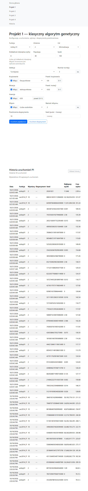

W wersji Word należy dodać dwa zwykłe zrzuty ekranu z VS Code. Pierwszy
powinien pokazywać fragment `backend/projects/p1/logic.py` z klasą
`GeneticAlgorithm` lub `BinaryChromosome`, a drugi fragment
`backend/projects/p1/routes.py` z endpointem uruchamiającym eksperyment.
Zrzut powinien być wykonany bezpośrednio z edytora VS Code, z widocznym
paskiem pliku i numerami linii. Nie należy tworzyć osobnych dekoracyjnych
diagramów kodu.

## 4. Implementacja algorytmu

### 4.1. Chromosom binarny

Każda zmienna jest kodowana osobnym fragmentem chromosomu. Liczba bitów
zależy od zakresu funkcji i ustawionej dokładności. Po podziale chromosomu
na fragmenty binarne każdy fragment jest zamieniany na liczbę rzeczywistą
z zakresu funkcji.

Równanie należy wstawić w Wordzie przez **Wstawianie -> Równanie**:

`x_i = a_i + (b_i - a_i) q_i / (2^{l_i} - 1)`

gdzie `q_i` jest liczbą całkowitą zakodowaną w bitach, `l_i` jest liczbą
bitów, a `[a_i,b_i]` jest zakresem zmiennej.

### 4.2. Operatory

W aplikacji zaimplementowano:

- selekcję najlepszych;
- selekcję najgorszych;
- selekcję ruletkową;
- selekcję turniejową;
- krzyżowanie jednopunktowe;
- krzyżowanie dwupunktowe;
- krzyżowanie jednorodne;
- krzyżowanie ziarniste;
- mutację brzegową;
- mutację jednopunktową;
- mutację dwupunktową;
- inwersję;
- elityzm według liczby lub procentu populacji.

Po ocenie populacji algorytm kopiuje osobniki elitarne, wybiera rodziców,
tworzy potomstwo przez krzyżowanie, mutuje je, opcjonalnie wykonuje inwersję
i uzupełnia kolejną populację. W minimalizacji wybierana jest najmniejsza
wartość funkcji, a w maksymalizacji największa.

### 4.3. Organizacja obiektowa

Konfigurację przechowuje `GAConfig`, chromosom obsługuje
`BinaryChromosome`, osobnika reprezentuje `Individual`, a cały przebieg
wykonuje `GeneticAlgorithm`. Statystyki epoki i wynik przebiegu są
przechowywane w osobnych strukturach danych.

## 5. Funkcje testowe

### 5.1. Ackley 01

Funkcja pochodzi z `opfunu.name_based.a_func.Ackley01`. Aplikacja obsługuje
wymiary od 2 do 30, a każda zmienna należy do przedziału `[-35,35]`.

Równanie do wstawienia w Wordzie:

`f(x) = -20 exp(-0.2 sqrt((1/n) sum_{i=1}^n x_i^2)) - exp((1/n) sum_{i=1}^n cos(2 pi x_i)) + 20 + e`

| Właściwość | Wartość |
|---|---:|
| Wymiar w badaniu | 5 |
| Kierunek | minimalizacja |
| Minimum | 0 |
| Argument minimum | `(0,0,0,0,0)` |

Wartość teoretycznego minimum wynosi 0, ale przy zastosowanym binarnym
kodowaniu nie jest ono reprezentowane dokładnie. Dla przedziału `[-35,35]`
i dokładności 8 cyfr aplikacja wyznacza 33 bity na jedną zmienną. Liczba
możliwych kodów wynosi wtedy `2^33`, więc środek przedziału wypada pomiędzy
dwoma sąsiednimi kodami. Najbliższe wartości, które można zakodować, to
około `-4,0745362639e-09` oraz `4,0745362639e-09`. Dlatego najlepsza
osiągalna wartość funkcji jest równa około `1,62981455e-08`, a nie dokładnie
0. Jest to ograniczenie dyskretyzacji chromosomu, a nie błąd działania
algorytmu.

**Rysunek 2.** Dwuwymiarowy przekrój Ackley 01 dla `x3=x4=x5=0`.

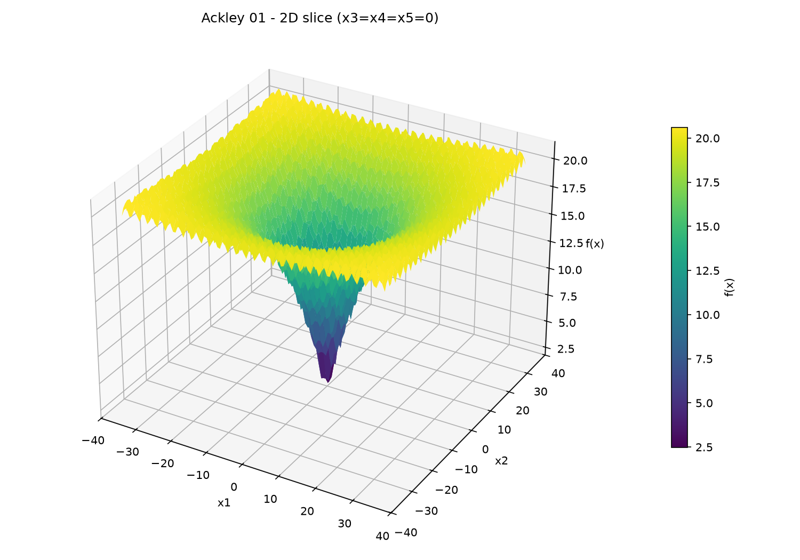

### 5.2. CEC 2014 F1

Funkcja pochodzi z `opfunu.cec_based.cec2014.F12014`. Jest to obrócona
funkcja eliptyczna o złym uwarunkowaniu. Obsługiwane są wymiary 10, 20, 30,
50 i 100. Zakres zmiennych wynosi `[-100,100]`.

| Właściwość | Wartość |
|---|---:|
| Wymiar w badaniu | 10 |
| Kierunek | minimalizacja |
| Minimum | 100 |
| Argument minimum | `x_global` z biblioteki `opfunu` |

Argument optimum dla 10 zmiennych:

`(50.355790, 64.926710, -59.682109, 66.140137, 21.177479, -64.393535,
-35.440285, 7.501043, 73.201094, 74.382166)`

**Rysunek 3.** Dwuwymiarowy przekrój CEC 2014 F1. Pozostałe zmienne są
ustalone na wartościach `x_global`.

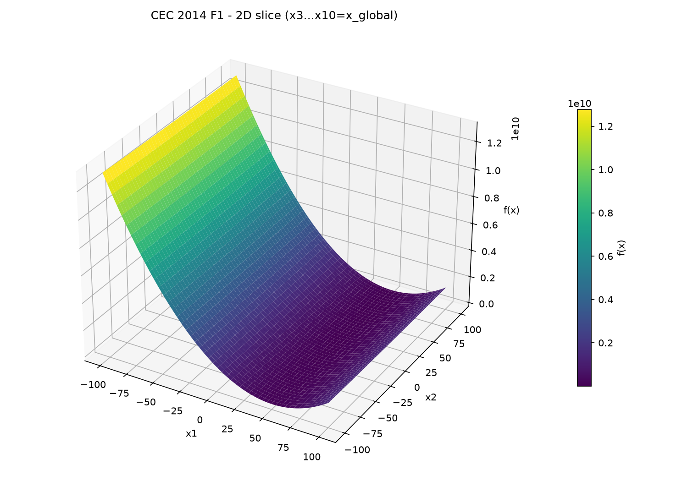

## 6. Metodyka badań

Wspólne ustawienia pierwszej serii:

| Parametr | Wartość |
|---|---:|
| Dokładność | 8 cyfr |
| Epoki | 100 |
| Selekcja | turniejowa |
| Rozmiar turnieju | 3 |
| Krzyżowanie | dwupunktowe |
| Prawdopodobieństwo krzyżowania | 0,80 |
| Mutacja | jednopunktowa |
| Prawdopodobieństwo mutacji | 0,02 |
| Inwersja | 0,05 |
| Elityzm | 2 osobniki |
| Powtórzenia | 10 |

Porównano populację 40 i 80 osobników. Następnie wykonano dodatkowe serie:

| Oznaczenie | Funkcja | Populacja | Epoki | Powtórzenia |
|---|---|---:|---:|---:|
| A40 | Ackley 01, 5 zmiennych | 40 | 100 | 10 |
| A80 | Ackley 01, 5 zmiennych | 80 | 100 | 10 |
| C40 | CEC F1, 10 zmiennych | 40 | 100 | 10 |
| C80 | CEC F1, 10 zmiennych | 80 | 100 | 10 |
| C200 | CEC F1, 10 zmiennych | 200 | 1000 | 10 |
| C10 | CEC F1, 10 zmiennych | 10 | 5000 | 10 |
| A200 | Ackley 01, 5 zmiennych | 200 | 1000 | 10 |

Pierwsza seria używała seedów `20261021-20261030`. Dodatkowe serie używały
seedów bazowych `20300000`, `20300100` i `20300200`.

## 7. Wyniki

Wszystkie wartości w tabelach są końcowymi wartościami funkcji. Ponieważ
badanie dotyczy minimalizacji, mniejszy wynik oznacza lepsze rozwiązanie.
`Średnia` i `odchylenie` dotyczą 10 powtórzeń. Czas jest średnim czasem
jednego przebiegu.

### 7.1. Zestawienie wszystkich konfiguracji

| Konfiguracja | Średnia | Odchylenie | Najlepszy | Najgorszy | Średni czas |
|---|---:|---:|---:|---:|---:|
| A40 | 7,781117 | 3,959438 | 3,279268 | 15,241120 | 0,142793 s |
| A80 | 2,808891 | 1,249687 | 1,177541 | 5,784062 | 0,333568 s |
| C40 | 35175982,695209 | 30065618,856460 | 5522096,560916 | 88354341,571106 | 0,278766 s |
| C80 | 14986860,309951 | 11056324,600942 | 2511818,135797 | 38758508,484090 | 0,558057 s |
| C200 | 5958704,646170 | 5243793,364041 | 340873,896624 | 14899354,706460 | 12,730358 s |
| C10 | 27789924,639921 | 18806539,947623 | 1529697,425491 | 59030205,786880 | 2,471029 s |
| A200 | 0,000000016298 | 0,000000000000 | 0,000000016298 | 0,000000016298 | 7,935352 s |

### 7.2. Wyniki poszczególnych powtórzeń

#### Ackley A40

| Seed | Wynik | Czas [s] |
|---:|---:|---:|
| 20261021 | 3,279268 | 0,146574 |
| 20261022 | 5,531326 | 0,179524 |
| 20261023 | 15,241120 | 0,154701 |
| 20261024 | 13,594353 | 0,152918 |
| 20261025 | 4,894218 | 0,149395 |
| 20261026 | 5,143547 | 0,131595 |
| 20261027 | 7,746566 | 0,127793 |
| 20261028 | 10,068359 | 0,131510 |
| 20261029 | 6,664390 | 0,128259 |
| 20261030 | 5,648023 | 0,125664 |

#### Ackley A80

| Seed | Wynik | Czas [s] |
|---:|---:|---:|
| 20261021 | 1,960163 | 0,344011 |
| 20261022 | 2,555958 | 0,367348 |
| 20261023 | 2,435915 | 0,348461 |
| 20261024 | 1,177541 | 0,327206 |
| 20261025 | 5,784062 | 0,332096 |
| 20261026 | 3,241538 | 0,321047 |
| 20261027 | 1,991259 | 0,317198 |
| 20261028 | 3,544512 | 0,333037 |
| 20261029 | 3,013694 | 0,326152 |
| 20261030 | 2,384269 | 0,319129 |

#### CEC C200

| Seed | Wynik |
|---:|---:|
| 20300000 | 2135817,087134 |
| 20300001 | 7035504,344629 |
| 20300002 | 11564902,523486 |
| 20300003 | 1083058,330545 |
| 20300004 | 1492411,659365 |
| 20300005 | 12179214,707709 |
| 20300006 | 14899354,706460 |
| 20300007 | 3512308,547449 |
| 20300008 | 5343600,658299 |
| 20300009 | 340873,896624 |

#### CEC C10

| Seed | Wynik |
|---:|---:|
| 20300100 | 1529697,425491 |
| 20300101 | 38129247,649674 |
| 20300102 | 31508883,296244 |
| 20300103 | 59030205,786880 |
| 20300104 | 24463166,974011 |
| 20300105 | 44294189,010689 |
| 20300106 | 7326134,219893 |
| 20300107 | 3250800,140660 |
| 20300108 | 31866293,673117 |
| 20300109 | 36500628,222544 |

### 7.3. Najlepsze rozwiązania

| Konfiguracja | Seed | Najlepsza wartość | Błąd względem optimum |
|---|---:|---:|---:|
| A40 | 20261021 | 3,279268 | 3,279268 |
| A80 | 20261024 | 1,177541 | 1,177541 |
| C40 | 20261028 | 5522096,560916 | 5521996,560916 |
| C80 | 20261030 | 2511818,135797 | 2511718,135797 |
| C200 | 20300009 | 340873,896624 | 340773,896624 |
| C10 | 20300100 | 1529697,425491 | 1529597,425491 |
| A200 | 20300200 | 0,000000016298 | 0,000000016298 |

Wektor A200 był równy w przybliżeniu:

`(-0,0000000041; 0,0000000041; -0,0000000041; -0,0000000041; -0,0000000041)`.

## 8. Interpretacja wyników

### 8.1. Ackley 01

Zwiększenie populacji z 40 do 80 przy 100 epokach zmniejszyło średni wynik
z `7,781117` do `2,808891`. Zwiększenie populacji do 200 i liczby epok do
1000 dało wynik `0,000000016298` w każdym z 10 powtórzeń. Jest to praktycznie
minimum 0. Dokładna różnica nie wynika tutaj z błędu zmiennoprzecinkowego,
lecz z tego, że wektor zerowy nie jest dostępny w użytej dyskretnej
reprezentacji binarnej. Wszystkie 10 powtórzeń osiągnęło ten sam najlepszy
osiągalny poziom.

Wynik wyjaśnia, dlaczego krótszy eksperyment nie zawsze schodził do poziomu
`1,62981455e-08`. Przy 100 epokach i mniejszej populacji algorytm może
zatrzymać się dalej od minimum osiągalnego przez chromosom. Losowość wpływa
na to, czy populacja znajdzie odpowiednie kombinacje bitów. Dla wymiaru 20
przy populacji 200 i 1000 epok uzyskano w jednym sprawdzeniu wartość
`1,650798`, co pokazuje, że zwiększenie wymiaru znacznie utrudnia znalezienie
minimum w tym samym budżecie obliczeniowym.

### 8.2. CEC 2014 F1

Dla CEC najlepszy średni wynik uzyskano przy 200 osobnikach i 1000 epokach:
`5958704,646170`. Konfiguracja 10 osobników i 5000 epok była wyraźnie
gorsza średnio: `27789924,639921`, mimo pięć razy większej liczby epok.

Oznacza to, że w tym eksperymencie różnorodność populacji była ważniejsza niż
samo wydłużenie procesu. Populacja 10 osobników szybciej wykonywała pojedynczy
przebieg (`2,471029 s`), ale dawała mniej stabilne i gorsze wyniki. Populacja
200 wymagała `12,730358 s`, lecz osiągnęła znacznie lepszą średnią.

Żadna konfiguracja CEC nie osiągnęła optimum 100. Jest to trudniejszy
benchmark, a uzyskane wyniki są przybliżeniami. Błędy powinny być
interpretowane względem tej samej funkcji, ponieważ wartości Ackley i CEC
mają zupełnie inne skale.

### 8.3. Czas obliczeń

Wzrost populacji zwiększa koszt jednej epoki, dlatego konfiguracje 200/1000
były znacznie wolniejsze. Nie można jednak oceniać algorytmu wyłącznie po
czasie: C200 uzyskała lepszy średni wynik niż C10. Wybór konfiguracji zależy
od kompromisu między jakością rozwiązania a czasem.

## 9. Wykresy wyników

Wykresy pokazują najlepsze pojedyncze uruchomienie danej konfiguracji.
W Wordzie należy wkleić obrazy jako grafiki, a nie pozostawić ścieżki do
pliku Markdown.

**Rysunek 4.** Ackley A80 - najlepsza i najgorsza wartość.

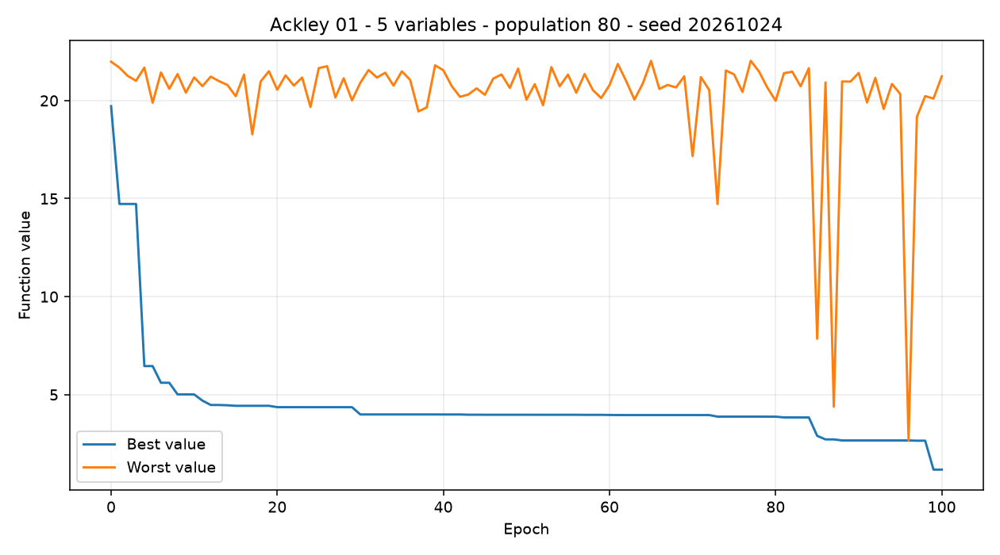

**Rysunek 5.** Ackley A200 - najlepsza i najgorsza wartość.

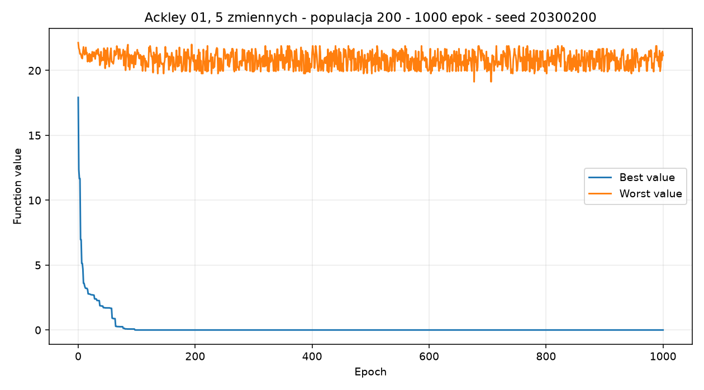

**Rysunek 6.** Ackley A200 - średnia i odchylenie standardowe.

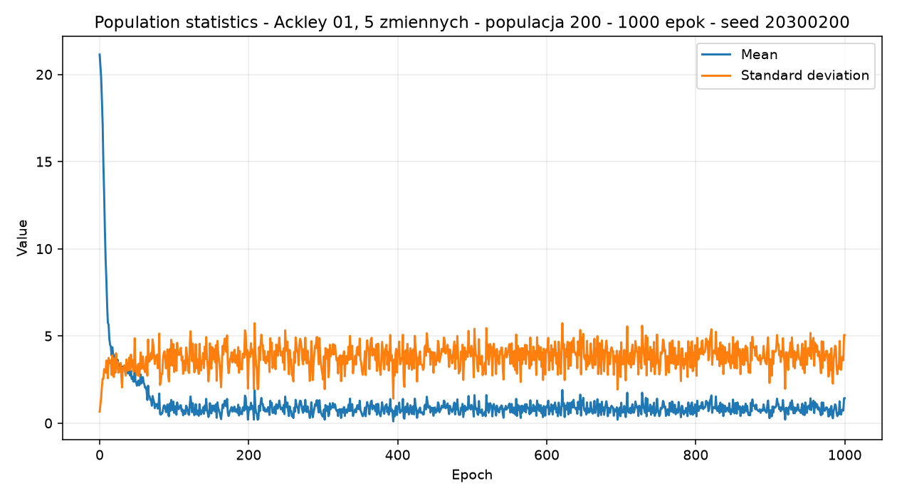

**Rysunek 7.** CEC C80 - najlepsza i najgorsza wartość.

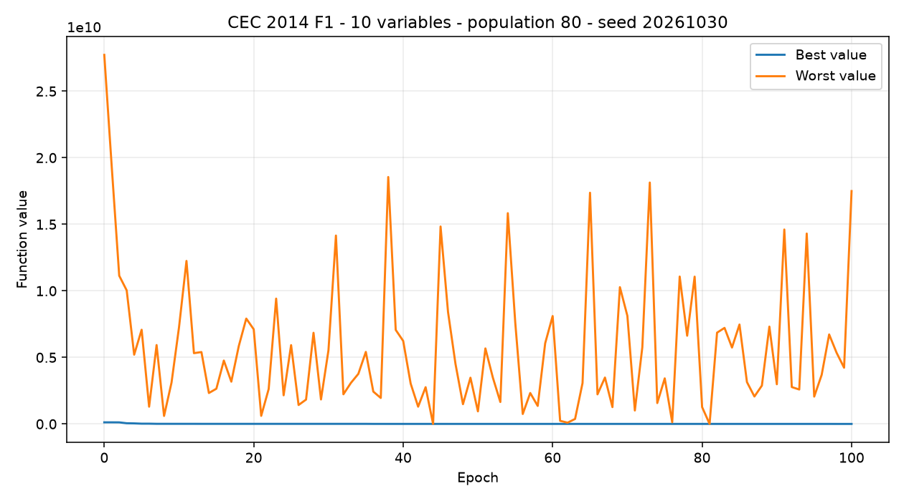

**Rysunek 8.** CEC C200 - najlepsza i najgorsza wartość.

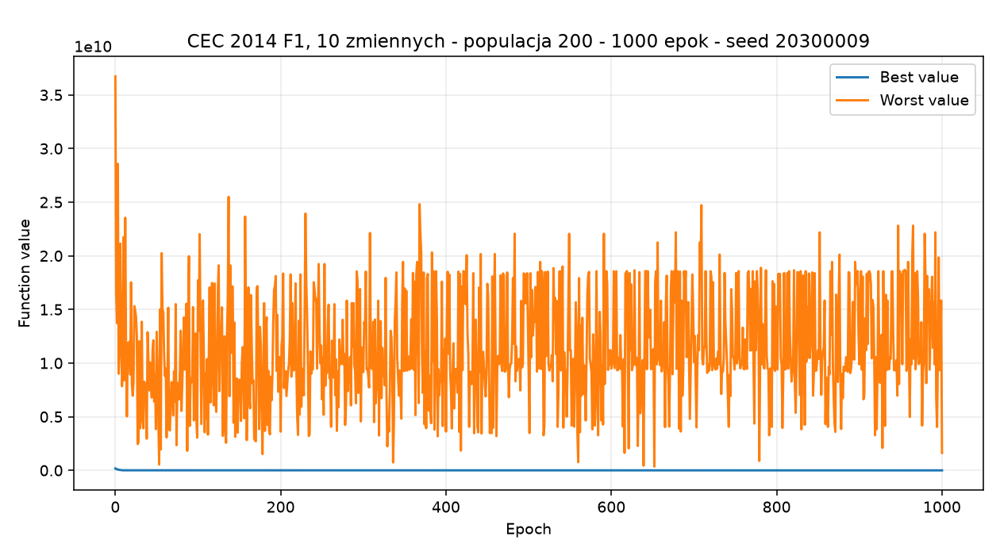

**Rysunek 9.** CEC C200 - średnia i odchylenie standardowe.

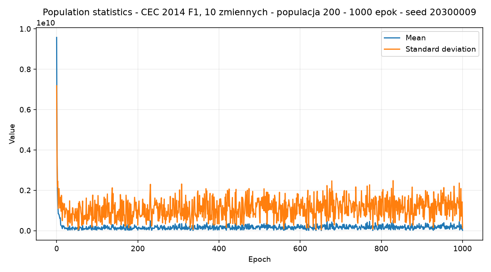

**Rysunek 10.** CEC C10 - najlepsza i najgorsza wartość.

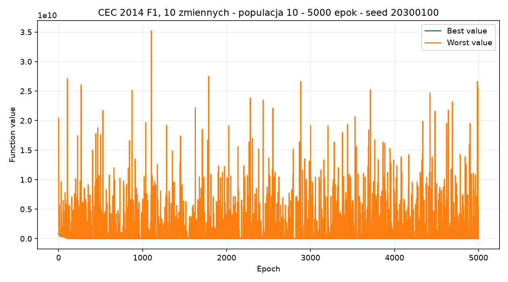

**Rysunek 11.** CEC C10 - średnia i odchylenie standardowe.

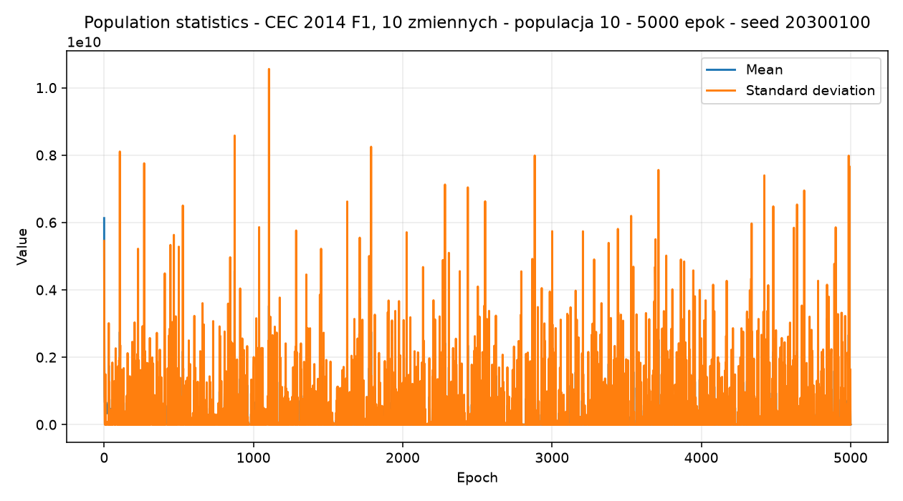

## 10. Kontrola minimalizacji i maksymalizacji

Główne eksperymenty wykonano dla minimalizacji, ponieważ wybrane benchmarki
mają znane minima. Sprawdzono również działanie drugiego kierunku.

| Cel | Funkcja | Wymiar | Populacja | Epoki | Seed | Wynik |
|---|---|---:|---:|---:|---:|---:|
| minimalizacja | Ackley 01 | 2 | 10 | 10 | 20261021 | 11,640998 |
| maksymalizacja | Ackley 01 | 2 | 10 | 10 | 20261021 | 22,279438 |

Wartość dla maksymalizacji jest większa, ponieważ algorytm wybiera w tym
trybie osobniki o większej wartości funkcji.

## 11. Zapis danych i testy

Wyniki są zapisywane w SQLite razem z seedem, konfiguracją, czasem,
najlepszym wektorem i historią epok. Dane eksperymentów wykorzystane w tym
sprawozdaniu znajdują się w:

- `sprawozdanie_p1/results.json` - pierwsze cztery konfiguracje;
- `sprawozdanie_p1/results_extended.json` - trzy dodatkowe konfiguracje.

Wykonane testy obejmowały chromosom, selekcję, krzyżowanie, mutację,
inwersję, elityzm, walidację API, zapis SQLite i eksport CSV. Pełny zestaw
49 testów zakończył się wynikiem `OK`. Test składni JavaScript i build
frontendu również przeszły poprawnie.

## 12. Wnioski

1. Aplikacja spełnia wymagania dotyczące binarnej reprezentacji i konfiguracji
   algorytmu.
2. Wszystkie wymagane operatory genetyczne są dostępne z poziomu GUI.
3. Dla Ackley największa badana populacja i 1000 epok pozwoliły praktycznie
   osiągnąć minimum 0 w każdym powtórzeniu.
4. Dla CEC lepsza była populacja 200 i 1000 epok niż populacja 10 i 5000
   epok. Sama liczba epok nie zastąpi odpowiedniej różnorodności populacji.
5. Większa jakość rozwiązania oznaczała dłuższy czas obliczeń.
6. CEC 2014 F1 pozostała trudna i w żadnej badanej konfiguracji nie osiągnięto
   jej optimum 100.

## 13. Elementy do uzupełnienia przed oddaniem

- [ ] wpisać imiona i nazwiska członków zespołu;
- [ ] dodać zrzut kodu z VS Code, np. `GeneticAlgorithm` i `BinaryChromosome`;
- [ ] przepisać wzory z sekcji 4 i 5 jako równania Word;
- [ ] wkleić obrazy jako grafiki do dokumentu Word/PDF;
- [ ] dodać film demonstracyjny trwający około 1-2 minut;
- [ ] spakować kod, raport i film do `P1_Nazwisko1Imie1_Nazwisko2Imie2.zip`.

## 14. Źródła

1. Biblioteka `opfunu`, klasy `Ackley01` i `F12014`.
2. Zestaw funkcji testowych CEC 2014.
3. FastAPI: <https://fastapi.tiangolo.com/>.
4. NumPy: <https://numpy.org/doc/>.
5. SQLAlchemy: <https://docs.sqlalchemy.org/>.
6. Chart.js: <https://www.chartjs.org/docs/latest/>.
