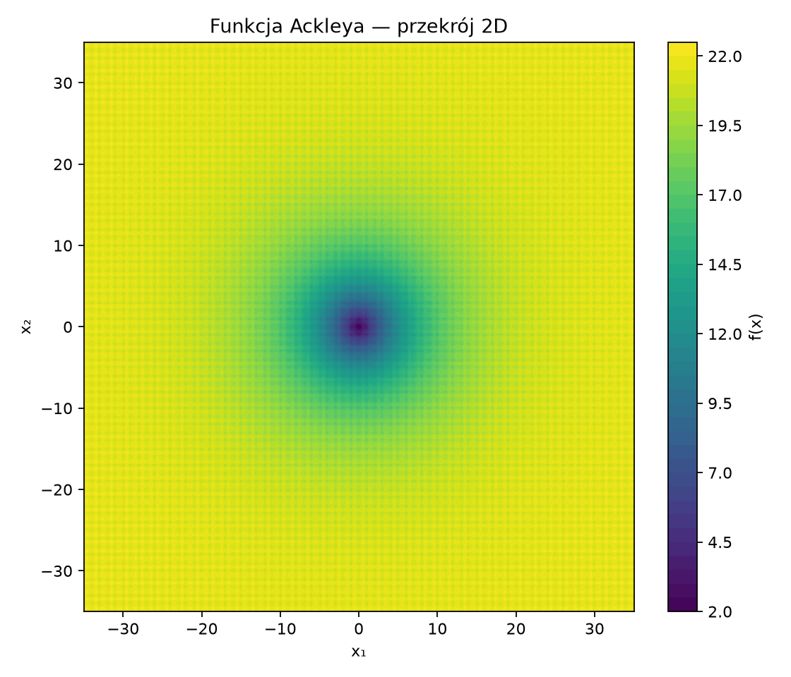
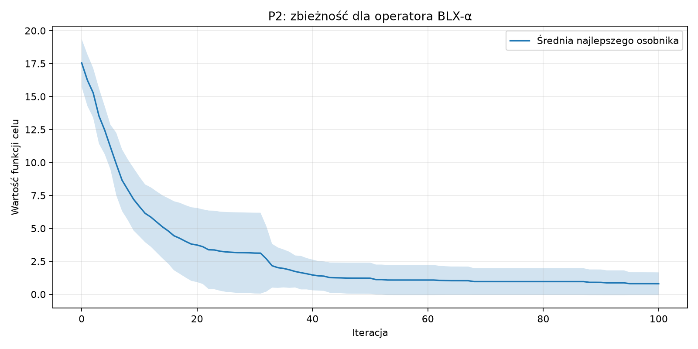
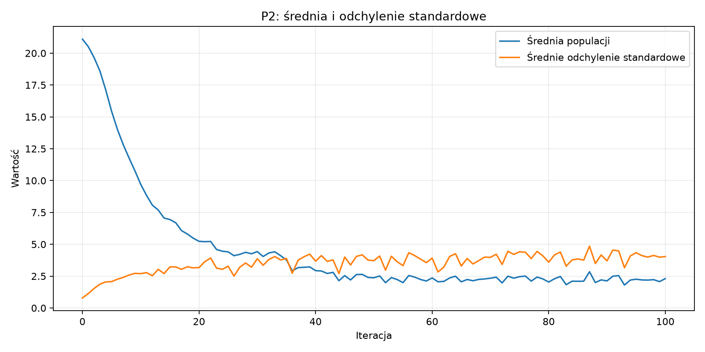
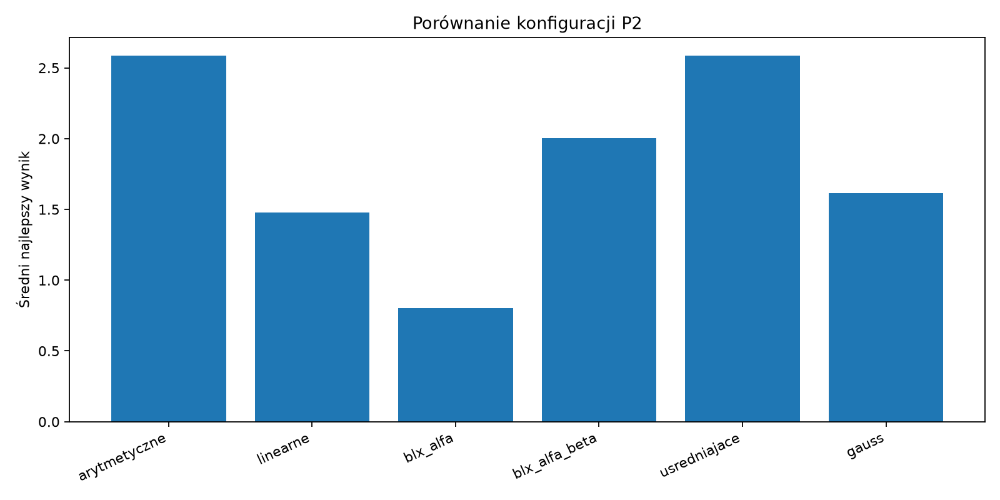
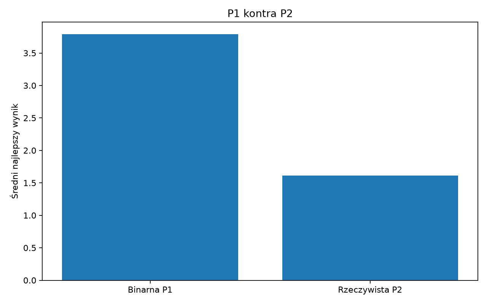

# Projekt 2 — implementacja chromosomu rzeczywistego

## 1. Cel projektu

Celem było zastąpienie binarnej reprezentacji chromosomu reprezentacją rzeczywistą oraz porównanie obu podejść w klasycznym algorytmie genetycznym.

## 2. Technologie

- Python 3.14.3, FastAPI, NumPy, SQLAlchemy i Uvicorn,
- `benchmark_functions` — funkcja Hyperellipsoid,
- `opfunu` — funkcja Ackley 01 oraz CEC2014 F3,
- JavaScript, Vite, Chart.js — interfejs i wykresy,
- Matplotlib — wykresy do sprawozdania.

## 3. Funkcja optymalizowana

W eksperymentach użyto funkcji Ackleya:

$$f(x) = -20e^{-0.2\sqrt{\frac{1}{n}\sum_{i=1}^n x_i^2}} - e^{\frac{1}{n}\sum_{i=1}^n\cos(2\pi x_i)} + 20 + e$$

Dziedzina eksperymentu: $x_i \in [-35, 35]$, optimum globalne: $f(0, ..., 0)=0$.

## 4. Wymagania środowiska

- Python 3.11+,
- zależności z `requirements.txt`,
- Node.js 20+ do zbudowania frontendu,
- uruchomienie backendu: `python -m uvicorn backend.main:app --reload`,
- zbudowanie frontendu: `npm install` oraz `npm run build` w katalogu `frontend`.

## 5. Zaimplementowane operatory

Chromosom jest wektorem liczb rzeczywistych ograniczanych do dziedziny funkcji. Zaimplementowano krzyżowanie arytmetyczne, linearne, BLX-α, BLX-αβ i uśredniające oraz mutację równomierną i Gaussa.

## 6. Wyniki

Eksperyment: 10 powtórzeń, populacja 40 osobników, 100 iteracji, selekcja turniejowa, elityzm 2 osobników.

### 6.1. Zbieżność i statystyki

### 6.2. Porównanie konfiguracji

| Konfiguracja | Średni najlepszy wynik | Odchylenie wyników | Średni czas |
|---|---:|---:|---:|
| arytmetyczne | 2.5867 | 0.7630 | 0.060718 s |
| linearne | 1.4772 | 0.8709 | 0.066164 s |
| blx_alfa | 0.8013 | 0.8625 | 0.078901 s |
| blx_alfa_beta | 2.0021 | 0.9225 | 0.068836 s |
| usredniajace | 2.5867 | 0.7630 | 0.057862 s |
| gauss | 1.6146 | 1.3179 | 0.073005 s |

### 6.3. Reprezentacja binarna a rzeczywista

| Reprezentacja | Średni najlepszy wynik | Odchylenie wyników | Średni czas |
|---|---:|---:|---:|
| Binarna P1 | 3.7874 | 1.1971 | 0.132761 s |
| Rzeczywista P2 | 1.6146 | 1.3179 | 0.075890 s |

## 7. Wnioski

Reprezentacja rzeczywista eliminuje etap kodowania i dekodowania bitów oraz pozwala bezpośrednio stosować operatory arytmetyczne. Ostateczna ocena jakości zależy od operatora, parametrów mutacji, liczby iteracji i rozmiaru populacji, dlatego porównanie należy interpretować razem z czasem obliczeń i odchyleniem wyników.
