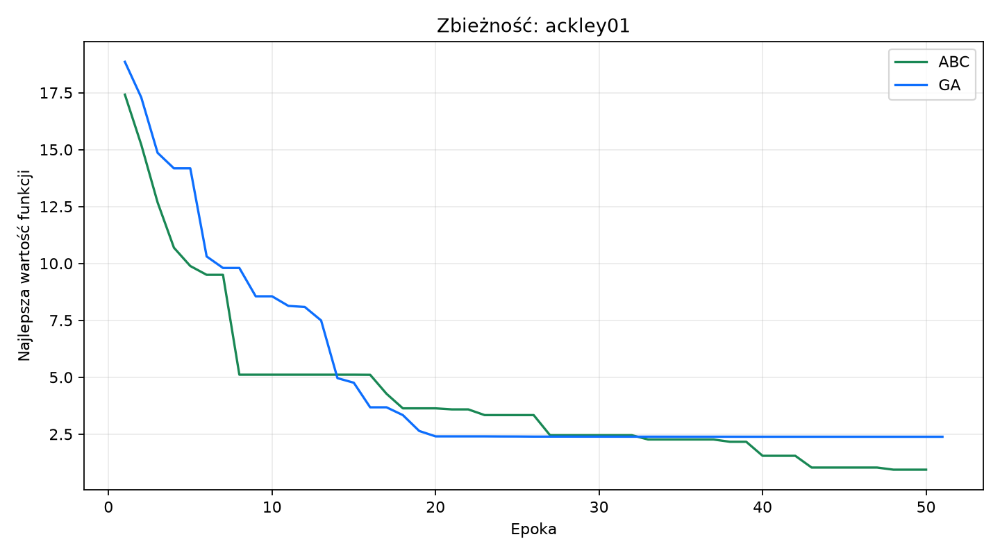
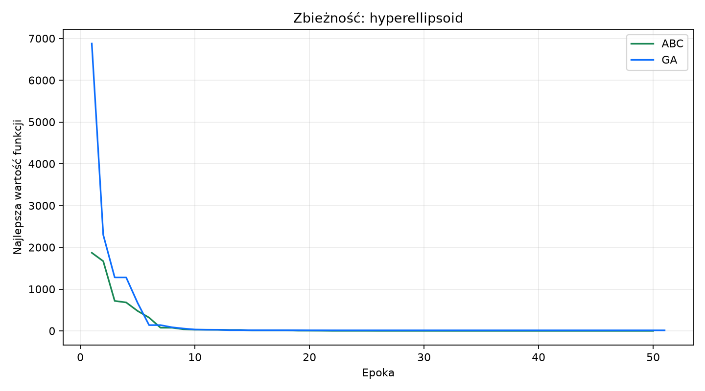
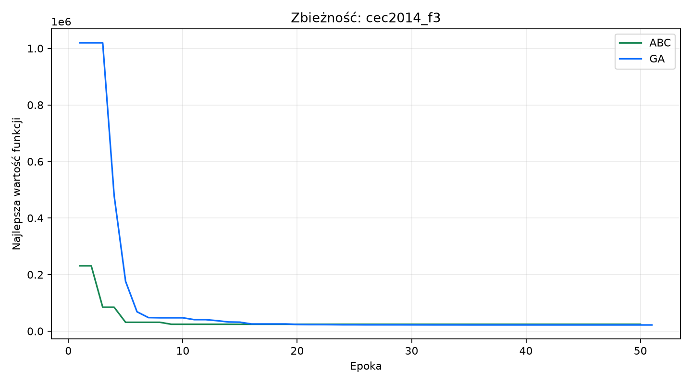
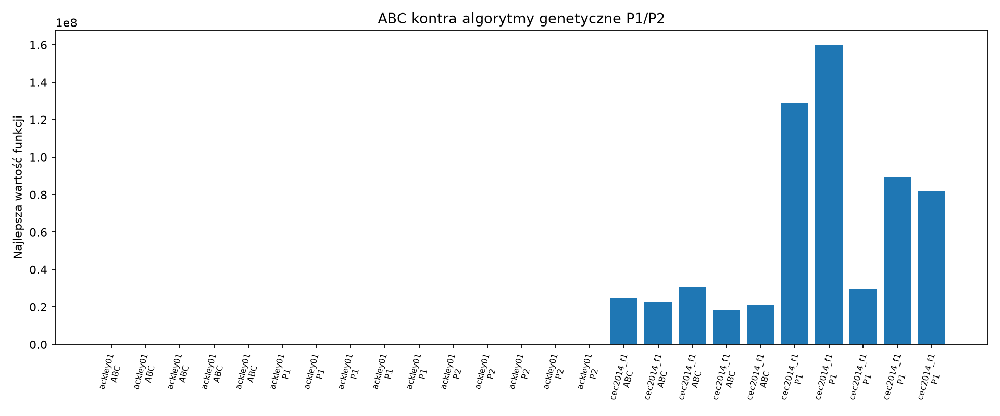
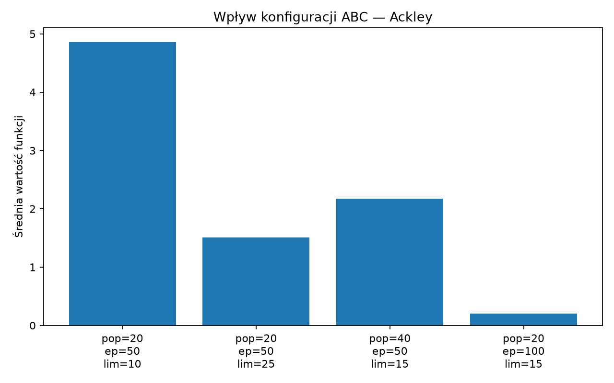

# Projekt 4 — Artificial Bee Colony w MealPy

## 1. Cel projektu

Celem jest wykorzystanie algorytmu inspirowanego biologią do optymalizacji
funkcji wielu zmiennych oraz porównanie go z algorytmem genetycznym z P2.
Wybrano Artificial Bee Colony (ABC), który modeluje zachowanie kolonii pszczół
poszukujących źródeł pożywienia.

## 2. Algorytm ABC

Każde źródło pożywienia jest kandydatem na rozwiązanie, a jego jakość jest
wartością funkcji celu. Kolonia składa się z pszczół pracujących, obserwujących
i zwiadowczych. Pszczoła pracująca modyfikuje własne źródło oraz porównuje nową
pozycję ze starą. Pszczoły obserwujące wybierają dobre źródła z
prawdopodobieństwem zależnym od jakości. Jeżeli źródło przez `n_limits` prób nie
zostanie poprawione, pszczoła zwiadowcza losuje nową pozycję.

### Pseudokod

```text
utwórz populację źródeł w granicach funkcji
oceń jakość każdego źródła
powtarzaj przez kolejne epoki:
    dla każdej pszczoły pracującej utwórz sąsiada i zachowaj lepszą pozycję
    oblicz prawdopodobieństwa wyboru źródeł
    dla pszczół obserwujących powtórz lokalne przeszukiwanie wybranych źródeł
    zastąp źródła przekraczające limit prób losowymi zwiadowcami
    zapisz najlepsze źródło
zwróć najlepsze rozwiązanie
```

### Przykład analityczny

Dla dwuwymiarowego źródła `x=(2, 4)` i sąsiada `x=(2.5, 3.5)` algorytm porównuje
wartości funkcji. Jeżeli sąsiad ma niższy wynik dla minimalizacji, zastępuje
dotychczasowe źródło. Jeśli źródło nie poprawia się przez ustaloną liczbę prób,
pszczółka zwiadowcza losuje nowe `x` z dziedziny. W ten sposób ABC łączy
eksplorację całej dziedziny z lokalnym doskonaleniem dobrych rozwiązań.

## 3. Funkcje i implementacja

Program obsługuje funkcję kwadratową, Ackley 01, Hyperellipsoid, CEC2014 F1 i CEC2014 F3.
Implementacja korzysta z `mealpy.swarm_based.ABC.OriginalABC`. Konfiguracja
obejmuje funkcję, wymiar, wielkość populacji, liczbę epok i `n_limits`.

## 4. Uruchomienie

```powershell
python p4_console.py --function ackley01 --dimensions 5 --population 40 --epochs 100 --repetitions 10
python sprawozdanie_p4/generate_report.py
```

## 5. Wyniki

Wyniki, tabele i wykresy są generowane automatycznie przez skrypt raportu.

## Wyniki eksperymentalne

Eksperyment wykonano dla 5 powtórzeń, populacji 20 osobników i 50 epok. W ABC użyto `n_limits=15`, a w GA krzyżowania BLX-α i mutacji Gaussa.

| Funkcja | ABC — średni wynik | GA — średni wynik | ABC — czas [s] | GA — czas [s] |
|---|---:|---:|---:|---:|
| ackley01 | 1.772225 | 5.923016 | 0.1314 | 0.0166 |



| hyperellipsoid | 0.003675 | 22.352744 | 0.1179 | 0.0156 |



| cec2014_f3 | 37156.516265 | 47382.639911 | 2.4744 | 0.0185 |



Dane źródłowe znajdują się w plikach [results.csv](./results.csv) i [results.json](./results.json).

## Wnioski

ABC wykorzystuje fazę pszczół pracujących, obserwujących i zwiadowczych. W porównaniu z GA nie używa krzyżowania ani mutacji chromosomów; nowe rozwiązania powstają przez lokalne przeszukiwanie sąsiedztwa źródeł pokarmu. Wybór algorytmu powinien uwzględniać nie tylko średnią wartość celu, ale także stabilność i czas obliczeń.

## Uzupełnienie eksperymentów

Dodano CEC2014 F1 oraz porównanie z algorytmami genetycznymi P1 i P2. Każdy wariant wykonano pięć razy.



Przetestowano również cztery konfiguracje ABC dla funkcji Ackley: zmieniano populację, liczbę epok i `n_limits`.

| Populacja | Epoki | n_limits | Średni wynik | Najlepszy wynik |
|---:|---:|---:|---:|---:|
| 20 | 50 | 10 | 4.861002 | 2.408553 |
| 20 | 50 | 25 | 1.508603 | 0.516667 |
| 40 | 50 | 15 | 2.171402 | 0.105800 |
| 20 | 100 | 15 | 0.202336 | 0.017118 |



CEC2014 F1 oraz pełne dane porównawcze znajdują się w [supplement_results.csv](./supplement_results.csv) i [supplement_results.json](./supplement_results.json).
